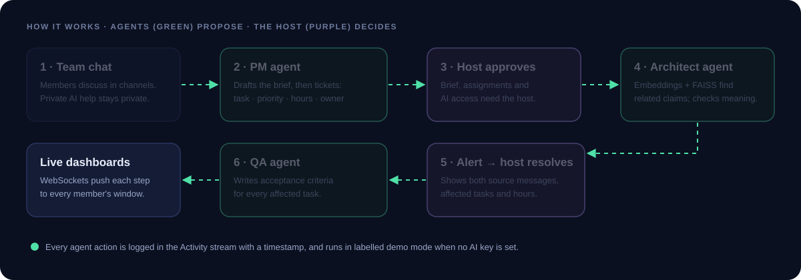
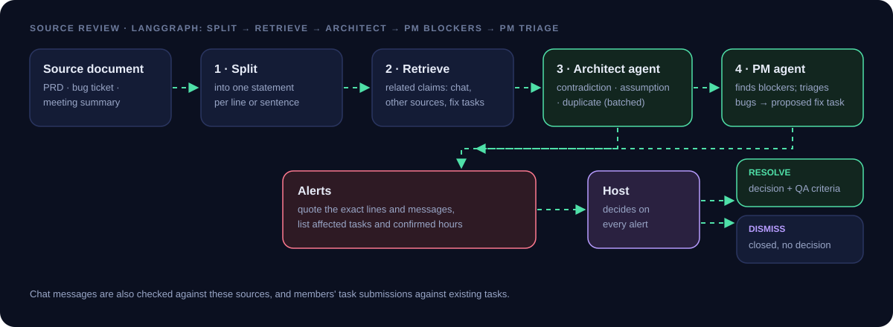
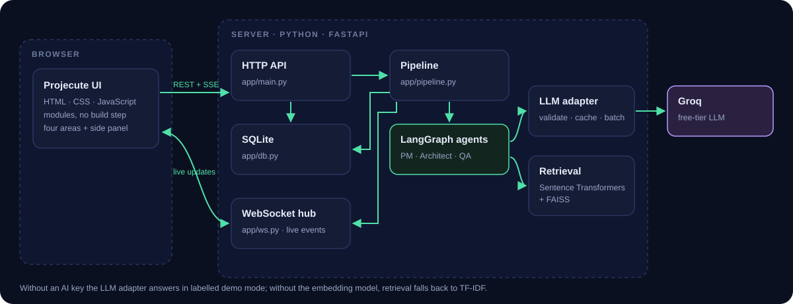

<p align="center">
  
</p>

<p align="center">
  <b>OlympAI Hackathon · Stage 1 prototype · Category 9–12 Advanced Coders</b><br>
  Team <b>Monarch Core</b> — Kavin K (team leader), Adrian Rohith, Sritharan N S
</p>

<p align="center">
  <b>Live demo (live AI):</b> <a href="https://projecute.onrender.com">projecute.onrender.com</a>
</p>

<p align="center">
  
  
  
  
  
  
</p>

---

## 🚀 Quick start for judges

### ▶ Try it live, with live AI: **<https://projecute.onrender.com>**

Nothing to install and no key needed: the hosted prototype runs the PM,
Architect and QA agents on a live language model for every visitor. Open the link
in **two browser tabs**, sign in as **Kavin K** (the host) in one and
**Sritharan N S** in the other, and follow the
[two-minute demo](#-two-minute-demo-script).

<details>
<summary>About the hosted version</summary>

- It runs on Render's free plan with the team's Groq key stored as a server
  secret. Visitors use the AI through the server and never see the key.
- A GitHub Action (`.github/workflows/keep-alive.yml`) pings it every 10 minutes,
  so it is awake when you click.
- To fit the free plan's memory, related-claim search uses the TF-IDF fallback.
  The live Architect agent still makes every conflict decision. The local
  versions below use the full Sentence Transformers + FAISS search.
- The data resets to the staged demo when the server restarts.

</details>

### Or run it yourself

Without a key these run in labelled demo mode; with a free Groq key they use
live AI too. Pick whichever is easiest:

| Option | Steps | Time |
|---|---|---|
| **A. Windows** | Install [Python 3.11+](https://www.python.org/downloads/) (tick *Add python.exe to PATH*), unzip, double-click **`run.bat`** | ~5 min the first time |
| **B. macOS / Linux** | Unzip, then run `bash run.sh` in a terminal | ~5 min the first time |

Then open the app in **two browser tabs**. Sign in as **Kavin K** (the host) in
one and **Sritharan N S** in the other, and follow the
[two-minute demo](#-two-minute-demo-script).

> **Want the live AI agents?** Get a free key at
> [console.groq.com/keys](https://console.groq.com/keys) (about a minute, no
> payment) and put it in the `.env` file the run script creates. The header
> shows **Live AI** or **Demo mode**, so you always know which you're seeing.

---

## ✅ Requirements checklist

Every requirement from the challenge brief, the submission rules and our Stage 1
deck, with where to see it.

**Challenge brief: Multiplayer AI Sprint & Architecture Manager**

| Requirement | Where it is met |
|---|---|
| Collaborative multi-agent sprint dashboard | Group workspace with live WebSocket updates in every member's window |
| Multiple team members assign tasks | PM agent proposes owners; any member submits tasks with a suggested owner (**Tasks → New task**); the host approves and reassigns |
| Agents cross-check PRDs, bug tickets and meeting summaries | **Sources**: each statement is checked against the chat, other sources and tasks (`pipeline.add_document`, source-review graph) |
| Detect blockers | PM agent flags blockers in sources as high-severity alerts with the affected tasks |
| Resolve architectural conflicts | Contradiction / assumption alerts with exact evidence; host resolves, decision recorded, QA writes criteria |
| 1. Simultaneous multi-user sessions with role-based agents (PM, QA, Architect) | Separate sessions per window; PM, Architect and QA agents in LangGraph; tests: `test_live_updates.py`, `test_privacy.py` |
| 2. Parse unstructured chat logs into structured tickets (Task, Priority, Estimated Hours) | PM agent → Pydantic `TicketProposal` (title, detail, priority, estimated_hours, owner) |
| 3. Conflict-detection agent flags duplicate issues or contradicting requirements across team submissions | Architect agent on chat messages, source documents and submitted tasks: duplicate / contradiction / assumption / unclear |
| Dataset: GitHub Issues, used to benchmark clustering, de-duplication and triage | 45 real duplicate pairs and 260 labelled issues from github.com/golang/go, scored for de-duplication, search, clustering and triage: [results](#real-github-issues-benchmark) (Kaggle's copy has no duplicate labels; see why there) |
| Target stack | Python, FastAPI + WebSockets, LangGraph, FAISS; the web UI is HTML/CSS/JS as our deck specifies |
| Deliverable: live collaborative web dashboard | <https://projecute.onrender.com>, plus local run scripts |
| Deliverable: multi-agent event stream logs | **Activity** (live, timestamped) and **Download event log** (JSON) |
| Deliverable: automated ticket generator | PM agent tickets from chat; fix tasks from bug tickets |
| Deliverable: simulated conflict-resolution tests | `scripts/simulate_conflict_resolution.py` (18 scenarios, end to end) and `tests/` |

**Submission rules**

| Rule | Where it is met |
|---|---|
| ZIP with all code files and assets | `projecute-submission.zip` (no secrets, no local database) |
| Main file named `main.py` | `main.py` in the root starts the app |
| README: setup and installation | [Setup and installation](#-setup-and-installation), [Quick start](#-quick-start-for-judges) |
| README: description of each file | [Every file and its purpose](#-every-file-and-its-purpose) |
| README: how to run the main code | [Running the main code](#-running-the-main-code) |
| README: dependencies | [Dependencies](#-dependencies), `requirements.txt` |
| README: AI tools used | [AI tools used](#-ai-tools-used) |
| Well-commented code | Every module, class and function has a docstring or comment |
| Code standards | `ruff` (pycodestyle, pyflakes, bugbear, pyupgrade, simplify, isort rules) passes with no findings |
| Original work, credited | No code copied from other projects; AI tools, libraries, models, fonts, services and the GitHub data are all credited with their licences in [Credits and licences](#-credits-and-licences) |

**Our Stage 1 deck**

| Slide | Promise | Where it is met |
|---|---|---|
| 4 | Individual AI chat; reusable outputs; one shared brief and assigned tasks; expose conflicts before implementation | Individual chat, individual workspace, Brief + Tasks, Alerts |
| 5 | Individual chat, group chat (public AI or private help with usage-only notices), individual workspace (content, emails, code as named items), group workspace; host approves assignments and group changes, including AI access | All four areas; host-only approvals and AI switches, enforced server-side |
| 6 | HTML/CSS/JS; FastAPI + WebSockets; SQLite; Sentence Transformers + FAISS; LangGraph; free-tier LLM adapter + labelled mock mode; Pydantic, retries, cache, backoff; Kaggle GitHub Issues subset + planted conflicts | All used, except that the GitHub issues come from GitHub itself rather than Kaggle's copy, which has no duplicate labels to score against (explained in [Data and evaluation](#-data-and-evaluation)); see also [How it works](#-how-it-works-the-agent-pipeline) |
| 7 | PM brief edited by team, approved by host; tickets with owner; embeddings + FAISS + Architect; flags with sources, dependent tickets, hours; host resolves; QA criteria; live dashboard | The pipeline, step by step |
| 8 | Two-user dashboard, ticket generator, event stream; duplicate precision/recall on real issues; 15+ planted conflicts with detection and evidence; private/public access, host approvals, live updates verified | Duplicate precision/recall on 45 real GitHub pairs; 18 planted conflicts (rules and live AI); 34 tests |
| 10 | Decision impact; each affected ticket once with team-confirmed hours; Parallel Futures; Human Unit Test; exact messages on every flag; host approves | Decisions list their tasks; impact line; Brief → Parallel Futures; task panel → Human Unit Test |
| 11 | Cache, batch, backoff, mock mode; evidence, "unclear", human review; separate storage and permission checks; one complete two-user workflow | Answer cache, batched Architect calls, retry with backoff, labelled demo mode; "unclear" alerts and **Dismiss**; permission tests |
| 14 | Explicit sharing only; group AI reads only group messages; private AI use announced with no content; host approves settings; public or synthetic demo text; keys in environment files | Privacy tests; `.env` and Render secrets |
| 17 | Find items by name in projects; items link to source chat; private until shared; team outputs beside decisions; editable text and code, never executed | Individual workspace and Team outputs |

## Contents

0. [Requirements checklist](#-requirements-checklist)
1. [The problem](#-the-problem)
2. [What Projecute does](#-what-projecute-does)
3. [Features](#-features)
4. [How it works](#-how-it-works-the-agent-pipeline)
5. [Data and evaluation](#-data-and-evaluation)
6. [Setup and installation](#-setup-and-installation)
7. [Running the main code](#-running-the-main-code) and [troubleshooting](#-troubleshooting)
8. [Two-minute demo script](#-two-minute-demo-script)
9. [Every file and its purpose](#-every-file-and-its-purpose)
10. [Dependencies](#-dependencies)
11. [Privacy, ethics and security](#-privacy-ethics-and-security)
12. [AI tools used](#-ai-tools-used)
13. [What was verified, and what was not](#-what-was-verified-and-what-was-not)
14. [Known limitations](#-known-limitations)
15. [Future scope: what Projecute doesn't do yet](#-future-scope-what-projecute-doesnt-do-yet)
16. [Credits and licences](#-credits-and-licences)
17. [Team and acknowledgements](#-team-and-acknowledgements)

---

## 🧩 The problem

- Separate AI chats leave teammates with **different project assumptions**.
- Long chat threads **bury useful outputs** and agreed decisions.
- Unclear goals cause **duplicate tasks** and **conflicting technical plans**.
- Teams need organised work, shared decisions and **source evidence**.

## 🎯 What Projecute does

Projecute is a **multiplayer AI sprint and architecture manager**. Each person can
use AI privately to explore and learn. The team works in a shared space where AI
agents turn the discussion into a brief and tasks, and flag conflicts before
anyone builds the wrong thing. **The host approves every change to the shared
plan.**

| Goal (from the deck) | How the prototype delivers it |
|---|---|
| Use individual AI chat to explore ideas, ask questions and learn | Private chats with streamed AI answers, history, rename, delete and search |
| Create and organise reusable outputs | Individual workspace: named items (content, email, code, image, audio) in projects |
| Confirm one shared project brief and generate assigned tasks | PM agent drafts the brief; the team edits it and the host approves; PM proposes tickets with owners |
| Expose conflicts and affected work before implementation | Architect agent flags duplicates and contradictions, with source messages, affected tasks and hours |
| *(challenge brief)* Cross-check PRDs, bug tickets and meeting summaries to detect blockers and resolve architectural conflicts | **Sources**: paste a PRD, bug ticket or meeting summary; the Architect checks every statement against the chat, the other sources and the tasks; the PM agent flags blockers and triages bugs into tasks |

---

## ✨ Features

### The four areas

| Area | What you can do |
|---|---|
| 💬 **Individual chat** | Private AI answers, ideas, explanations and learning. Streamed Markdown replies, chats grouped by date, rename, delete and search. Nothing here reaches the group unless you share it. |
| 👥 **Group chat** | Channels, replies, reactions and a typing indicator. Choose **public AI** (the answer is posted for everyone) or **private help** (only you see it; the group sees just *"Name used AI"*). The host can switch either mode off. |
| 🗂️ **Individual workspace** | Generate named items: content, email drafts, code (stored as text, never executed), images and audio. Organise them in projects, search by name, edit them, follow a link back to the source chat, and share an item to the group or make it private again. |
| 🏢 **Group workspace** | Seven sections with live count badges: **Brief** (with Parallel Futures), **Sources** (PRDs, bug tickets, meeting summaries), **Tasks** (any member can submit one; the host approves), **Decisions** (each lists the tasks it changes), **Alerts** (resolve, or dismiss a false alert), **Activity** (the multi-agent event stream, downloadable as JSON) and **Team outputs**. |

### The AI agents

| Agent | Role |
|---|---|
| 🧭 **PM agent** | Reads the team chat, drafts the **project brief**, then proposes **tickets: task, priority, estimated hours and a suggested owner**. Finds **blockers** in meeting summaries and other sources, and **triages bug tickets** (category, priority, hours) into proposed fix tasks |
| 🏗️ **Architect agent** | Uses embeddings and FAISS to find claims related to each new chat message, source-document statement or submitted task, then decides: **duplicate**, **contradiction**, **assumption mismatch**, **unclear** or none |
| 🧪 **QA agent** | After the host resolves an alert, writes **acceptance criteria** for every affected task |

The agents run as three **LangGraph** graphs: planning (`pm_brief → pm_tickets`),
chat review (`retrieve → architect`) and source review
(`split → retrieve → architect → pm_blockers → pm_triage`).

### Innovations (deck slide 10)

- **Decision impact.** Approved decisions are linked to the tickets they affect.
  Each affected ticket is shown **once**, and the alert totals only the
  **team-confirmed** estimated hours (e.g. *"Impact: 4 tasks, about 20 hours"*).
- **Parallel Futures.** Members answer the same concrete scenario independently.
  Comparing the answers reveals the hidden assumptions behind them.
- **Human Unit Test.** The task's creator and its assignee each describe the task
  in their own words. A mismatch is flagged before work starts.
- **Evidence on every flag.** Every alert quotes the exact source messages and who
  wrote them, or the exact line of the PRD, bug ticket or meeting summary. The
  host approves the resolution, or dismisses a false alert without recording a
  decision.

### Host approvals

The host approves the **brief**, the **task assignments** (including tasks members
submit and fix tasks the PM agent proposes from bug tickets), every **task edit**,
**alert resolutions and dismissals** and **who can use AI** in the group. The
server enforces this, not just the interface, and tests cover it.

---

## ⚙ How it works: the agent pipeline

<p align="center">
  
</p>

### The logic, step by step

1. **Brief.** The PM agent reads the busiest channel, so off-topic chatter in
   `#general` stays out, and drafts a structured brief: title, summary, goals,
   non-goals and assumptions. Any edit sends the brief back to *draft* until the
   host approves it again.
2. **Tickets.** After approval, the PM agent proposes 3–6 tickets. Near-duplicate
   proposals are dropped. Owners are matched to team members. The host approves
   the assignments.
3. **Conflict review.** Once a brief is approved, every new non-question message
   is compared with earlier messages:
   - **Retrieval:** `all-MiniLM-L6-v2` sentence embeddings searched with a FAISS
     inner-product index. A TF-IDF fallback is used if the model can't load.
   - **Meaning check:** the Architect agent classifies each related pair and
     keeps the most serious issue (contradiction > assumption > duplicate >
     unclear).
   - **Impact:** related tickets are retrieved for *both* source messages,
     de-duplicated, and their confirmed hours summed.
4. **Sources.** Any member adds a PRD, bug ticket or meeting summary. It is split
   into statements, and each is retrieved against the chat, the other sources
   and (for bugs) existing bug reports and fix tasks:
   - **Conflicts:** the Architect keeps contradictions and assumption mismatches,
     one alert per statement, quoting every message or line it disagrees with.
     The chat review also checks new messages against these sources.
   - **Blockers:** the PM agent lists statements that stop or delay work ("blocked
     until…", "waiting on…") as high-severity alerts with the affected tasks.
   - **Bugs:** a bug ticket is triaged (category, priority, hours) into a
     proposed *Fix* task for the host to approve. A report that repeats an earlier
     bug is flagged as one duplicate alert instead. A bug *in* a feature is not
     treated as a duplicate of the feature.
   - **Rate limits:** at most 8 Architect checks run per document, strongest
     matches first, to stay inside free-tier limits.
5. **Task submissions.** Any member can submit a task. It waits for the host, and
   the Architect checks it against existing tasks so the same work isn't added
   twice.
6. **Resolution.** The host picks or writes a resolution. It is recorded as a
   **decision** listing the tasks it changes, and the QA agent writes acceptance
   criteria for each affected task. A false alert can be **dismissed** instead,
   with no decision and no task changes.
7. **Live updates.** Every step is broadcast over WebSockets to each member's
   open windows, and logged in **Activity** with a timestamp. **Download event
   log** saves the whole multi-agent event stream as JSON.

<p align="center">
  
</p>

### Reliable AI output

- Every AI JSON answer is validated with a **Pydantic schema**
  (`app/schemas.py`). If it doesn't validate, the error is sent back to the model
  for another try.
- Answers are **cached**. Architect checks are **batched**: the related pairs
  for one message or document go to the model in a single call, and any pair
  missing from the reply falls back to its own call. Rate limits and timeouts are
  retried with **exponential backoff**. If the main model (`gpt-oss-120b`) hits a
  Groq rate limit, the app switches at once to the backup model (`gpt-oss-20b`),
  which has its own limits, and chat answers use light reasoning to save tokens.
  Together, as slide 11 promises, these keep the free tier usable.
- With an API key the app always stays in **live mode** (the live site never shows
  Demo mode). If the AI service still fails after the retries, chat replies ask you
  to try again, and an agent step uses the built-in rules for that one step.
- Without an API key the app runs in **labelled demo mode**: text answers become
  fixed stand-ins, and the decisions come from transparent text rules. The header
  always says which mode is active.

### Architecture

<p align="center">
  
</p>

---

## 📊 Data and evaluation

| Data | Where | Used for |
|---|---|---|
| **Real GitHub issues** from [github.com/golang/go](https://github.com/golang/go/issues): 45 duplicate pairs (36 originals) and 260 labelled issues | `data/github_issues_golang.json` (built by `scripts/fetch_github_issues.py`) | Benchmark: de-duplicate, search, cluster and triage |
| 18 planted conflict scenarios, each with 5 distractor claims | `scripts/evaluate_conflicts.py` | Detection and evidence correctness (deck: *15+ planted conflicts*) |
| The same 18 scenarios run end to end | `scripts/simulate_conflict_resolution.py` | Simulated conflict-resolution tests |
| Demo team conversation (written by the team, synthetic) | `scripts/seed_demo.py` | The staged demo: guest checkout, then a new login requirement |
| 16 labelled duplicate pairs (synthetic, marked SYNTHETIC) | `data/sample_duplicates_SYNTHETIC.csv` | Smoke test for duplicate precision and recall |

### Real GitHub Issues benchmark

**Why GitHub's own data rather than Kaggle's copy.** The deck and the challenge
name the Kaggle GitHub Issues dataset. Its dumps carry issue titles and bodies,
but no record of which issues are duplicates, so they cannot score
de-duplication. We used the same kind of data, real GitHub issues, taken from the
Go project with its **own answer key**:
- **Duplicates:** the maintainers' *"Duplicate of #N"* comments.
- **Triage:** the `FeatureRequest`, `Documentation`, `NeedsFix` and
  `release-blocker` labels.

`scripts/evaluate_duplicates.py` still accepts any labelled CSV, including one
built from Kaggle.

**How each part is scored:**
- **De-duplication:** every real pair is matched with a *hard* negative, the same
  duplicate paired with another issue from the same Go component (e.g. two
  `cmd/compile:` issues).
- **Search:** each duplicate is ranked against all 36 originals.
- **Clustering:** groups found by similarity are compared with the maintainers'
  duplicate groups.
- **Triage:** compares the PM agent's category and priority with the labels.

Measured on 22 October 2026, with Sentence Transformers + FAISS search and the
live model `openai/gpt-oss-120b` on Groq:

```
De-duplication (45 real duplicates + 45 same-component hard negatives)
  Search alone, fixed threshold 0.50     precision 0.750  recall 0.933  F1 0.832
  Architect agent, built-in rules        precision 0.808  recall 0.467  F1 0.592
  Architect agent, live LLM (80 pairs)   precision 1.000  recall 0.575  F1 0.730

Search: each duplicate ranked against all 36 originals
  recall@1 0.600   recall@5 0.756

Clustering (81 issues, 36 true duplicate groups)
  fixed threshold 0.50                   25 groups  pairwise precision 0.320  recall 0.859  F1 0.466
  best threshold 0.75 (tuned on this set) 43 groups  pairwise precision 0.565  recall 0.609  F1 0.586

Triage by the PM agent (bug / feature / docs)
  built-in rules, 260 issues             accuracy 0.558   release-blockers marked High 4/8
  live LLM, 40 issues                    accuracy 0.800   release-blockers marked High 1/1, false High 6/39
```

**What this shows:**
- **Search** is the strong part. It surfaces 93% of real duplicates, and the
  true original is in the top 5 for three-quarters of them.
- **The live Architect is careful.** Every pair it called a duplicate really was
  one (precision 1.00), but it confirms only 58%, because Go duplicates are often
  worded very differently. In the app that's the right trade-off: a missed
  duplicate costs little, while a false alert wastes the host's time.
- **Live AI triage** is clearly better than the rules (80% vs 56%).
- **Clustering** whole issue sets is the weakest part, and the most obvious next
  improvement.

These are measurements on a small real sample, not a general accuracy claim. As
the deck says, *Stage 1 makes no accuracy claims*. Raw results are in
`data/github_issues_golang_results.json`. Re-run them with
`python -m scripts.evaluate_github_issues --live 40`.

### Planted conflicts, simulation, tests

```
pytest                         34 passed

evaluate_conflicts             18 scenarios, each with 5 distractors
  built-in rules               detection 18/18 · evidence 16/16
  live LLM (gpt-oss-120b)      detection 17/18 · evidence 15/16
                               (the miss: an "unclear" pair the model called "no issue", so no false alarm)

simulate_conflict_resolution   18 scenarios end to end (built-in rules)
                               detect 18/18 · evidence 16/16 · impact 16/16 · resolve 16/16
                               QA criteria 15/15 · closed stays closed 16/16
                               flagged scenarios that completed every step: 16/16

evaluate_duplicates            16 synthetic pairs · precision 1.000 · recall 1.000
```

> **Honest note.** The planted scenarios and the synthetic pairs were written by
> the team, so they show the pipeline works end to end; the GitHub benchmark
> above is the real-world check. With the TF-IDF fallback instead of embeddings
> (used on the free hosted demo), an earlier run scored 17/18 on planted conflicts.

To score your own labelled pairs (for example, a Kaggle subset you have labelled):

```bash
python -m scripts.evaluate_duplicates path/to/labelled.csv --limit 500
```

The CSV needs one labelled pair per row: `text_a,text_b,is_duplicate` (or
`title_a,title_b,label`).

---

## 🛠 Setup and installation

**Requirements:** Python 3.11 or newer, and about 2 GB of disk space for
PyTorch and the embedding model.

The easiest way is `run.bat` (Windows) or `bash run.sh` (macOS/Linux): each one
creates a virtual environment, installs everything once, creates `.env`, starts
the app and opens your browser. To do the same by hand:

```bash
git clone https://github.com/kavin-beep/Projecute-OlympAI-Hackathon.git
cd Projecute-OlympAI-Hackathon
python -m venv .venv
# Windows: .venv\Scripts\activate    macOS/Linux: source .venv/bin/activate
pip install -r requirements.txt
```

**Optional, for live AI:** copy `.env.example` to `.env` and put your own
[Groq](https://console.groq.com) key in `GROQ_API_KEY`. Without a key the app
runs in **labelled demo mode**, and the whole demo still works.

The first run downloads the `all-MiniLM-L6-v2` embedding model (about 90 MB)
from Hugging Face. Offline, the app uses the TF-IDF fallback instead.

## ▶ Running the main code

```bash
python main.py
```

Open <http://127.0.0.1:8000> in **two browser windows**. Sign in as **Kavin K**
(the host) in one and **Sritharan N S** in the other. Each window keeps its own
session. On a fresh database the demo team and project are created
automatically.

| Command | What it does |
|---|---|
| `python main.py` | Start the web app (the main entry point) |
| `python -m scripts.seed_demo` | Reset to the staged demo (stops just before the conflict) |
| `python -m scripts.seed_demo --full` | Reset and also run the conflict and its resolution |
| `python -m pytest` | Run the tests |
| `python -m scripts.evaluate_conflicts` | Planted-conflict evaluation |
| `python -m scripts.evaluate_duplicates data/sample_duplicates_SYNTHETIC.csv` | Duplicate evaluation (synthetic smoke test) |
| `python -m scripts.simulate_conflict_resolution` | Simulated conflict-resolution tests, end to end |
| `python -m scripts.evaluate_github_issues` | Real GitHub Issues benchmark: de-duplicate, cluster, triage (add `--live 40` for the live LLM) |
| `python -m scripts.fetch_github_issues` | Re-download the GitHub Issues benchmark data (already included) |

**Settings** (environment variables or `.env`):

| Variable | Default | Purpose |
|---|---|---|
| `GROQ_API_KEY` | *(empty)* | Enables live AI; empty means demo mode |
| `GROQ_MODEL` | `openai/gpt-oss-120b` | Main AI model (OpenAI open-weight, served by Groq) |
| `GROQ_FALLBACK_MODEL` | `openai/gpt-oss-20b` | Backup model used automatically when the main one hits a Groq rate limit |
| `HOST` / `PORT` | `127.0.0.1` / `8000` | Where the server listens |
| `DEMO_PASSCODE` | *(empty)* | When set, **Load demo** asks for it before resetting |
| `PROJECUTE_DB` | `data/projecute.db` | SQLite database file |

### Run with Docker (optional)

The same app runs unchanged in a container on any Docker host, and live updates
over WebSockets keep working. Pass the API key as an environment variable or a
host secret, never in the files. `deploy/huggingface/README.md` holds the page
settings for a Hugging Face Docker Space, which needs a paid Hugging Face plan.

```bash
docker build -t projecute .
docker run -p 7860:7860 -e GROQ_API_KEY=your-key -e DEMO_PASSCODE=choose-one projecute
```

## 🩺 Troubleshooting

| Problem | Fix |
|---|---|
| `python` is not recognised (Windows) | Reinstall Python 3.11+ and tick **Add python.exe to PATH**, then open a new terminal |
| The page doesn't load right away | The first start downloads and loads the AI embedding model; wait about a minute. `run.bat` / `bash run.sh` open the browser when it's ready |
| `Address already in use` / port 8000 busy | Start on another port: `PORT=8010 python main.py` (Windows: `set PORT=8010` then `python main.py`) |
| Header says **Demo mode** | No Groq key is set. Add one to `.env` and restart; see Quick start |
| No internet on first run | The app still starts and uses the TF-IDF search fallback; Settings → Advanced shows which search is active |
| Want a clean demo again | Press **Load demo** on the sign-in screen, or run `python -m scripts.seed_demo` |

---

## 🎬 Two-minute demo script

1. **The problem (10s).** Two windows side by side: Kavin the host and Sritharan
   a member. *"Two people, one project, and no shared idea of what was agreed."*
2. **Shared workspace → Brief (20s).** The PM agent wrote the brief from the
   team's own chat, and the host approved it. **Tasks** shows the tasks with
   owners, priorities and estimates the team confirmed.
3. **The scope change (25s).** In Sritharan's window, post in `#checkout`:
   > Update from the client: every customer must log in before they can pay, so
   > checkout now requires an account.
4. **The alert (35s).** In Kavin's window, open **Alerts**. The card says the
   statements disagree about checkout and quotes **both source messages** with
   their authors. It states the impact, for example *"Impact: 4 tasks, about 20
   hours"* (the exact tasks depend on what the PM agent proposed).
5. **The host decides (20s).** Pick a resolution and press **Approve this
   resolution**. Sritharan's window updates on its own: the alert is resolved, a
   decision is recorded, and the QA agent's acceptance criteria appear.
6. **Privacy (20s).** In Sritharan's window, switch to **Private help** and ask
   anything. Kavin's window shows only *"Sritharan N S used AI"*, with no prompt,
   answer or topic. Finish on **Activity**: every agent action, timestamped.

**Extra (60s): PRDs, bug tickets and meeting summaries.** Open **Sources → Add a
source** and paste any of these:

| Type | Title | Text to paste | What happens |
|---|---|---|---|
| PRD | Checkout PRD v2 | `- Every customer must create an account and log in before checkout.`<br>`- The checkout summary screen shows the cart total before payment.` | Contradiction alert quoting the PRD line and the chat messages that said no login |
| Meeting summary | Sprint sync | `- Payment step is blocked until the payment provider approves our sandbox account.`<br>`- QA is waiting on test cards from finance.` | Two blocker alerts with the affected tasks |
| Bug ticket | Wrong total on summary | `The summary screen before payment shows the cart total without shipping, so the total is wrong.` | Triaged into a proposed *Fix* task; paste a reworded copy as a second bug ticket to see it flagged as a duplicate |

---

## 📁 Every file and its purpose

| File | Purpose |
|---|---|
| `main.py` | **Main entry point.** Starts the web server (`python main.py`); reads `HOST`, `PORT` and `OPEN_BROWSER` |
| `run.bat` | One-command start for Windows: virtual environment, one-time install, `.env`, start, open browser |
| `run.sh` | The same one-command start for macOS and Linux |
| `render.yaml` | Render Blueprint for the hosted live demo (free plan); the Groq key is entered in Render as a secret |
| `requirements-render.txt` | Lighter dependency list for the hosted demo (no PyTorch, so it fits in 512 MB) |
| `.github/workflows/keep-alive.yml` | Pings the hosted demo every 10 minutes so it never sleeps |
| **app/** | **Backend (Python)** |
| `app/__init__.py` | Marks `app` as a Python package |
| `app/main.py` | FastAPI application: every HTTP endpoint for the four areas, sign-in, permission checks (member, host, same group), server-sent events for streamed chat, the WebSocket endpoint and the static frontend |
| `app/pipeline.py` | The group pipeline as plain functions over the database: brief → tickets → conflict review → decision → QA. Returns the live events to broadcast |
| `app/agents.py` | The PM, Architect and QA agents, Parallel Futures and Human Unit Test comparisons, the two LangGraph graphs (planning and review), and the rule-based demo-mode logic |
| `app/llm.py` | Groq adapter: JSON validation with retries, answer cache, exponential backoff, streaming, and labelled demo mode. Never logs or returns the key |
| `app/retrieval.py` | Related-claim search with Sentence Transformers + FAISS, and the TF-IDF fallback |
| `app/schemas.py` | Pydantic schemas that every AI JSON answer is validated against |
| `app/db.py` | SQLite schema, query helpers, membership and host checks, activity log |
| `app/ws.py` | WebSocket hub: tracks open windows per user and pushes live events |
| `app/media.py` | Image and audio adapter; labelled placeholder mode when no provider key is set |
| **static/** | **Frontend (HTML, CSS, JavaScript, no build step)** |
| `static/index.html` | Page layout: sign-in screen, navigation rail, the four areas, side panel |
| `static/styles.css` | Visual design, light and dark themes, mobile layout |
| `static/logo.svg` | Projecute logo (original) |
| `static/js/app.js` | App start-up, sign-in, navigation between areas, theme, Load demo |
| `static/js/api.js` | API calls, streamed responses, the live WebSocket connection and event bus |
| `static/js/ui.js` | Shared UI helpers: elements, icons, dialogs, toasts, safe Markdown, time formatting |
| `static/js/chat.js` | Individual chat |
| `static/js/group.js` | Group chat: channels, messages, reactions, replies, AI modes, host controls |
| `static/js/workspace.js` | Individual workspace: projects, named items, sharing |
| `static/js/board.js` | Group workspace: Brief, Tasks, Decisions, Alerts, Activity, Team outputs, Parallel Futures, Human Unit Test |
| **scripts/** | **Command-line tools** |
| `scripts/seed_demo.py` | Resets the database and stages the demo team, chat, approved brief and tasks |
| `scripts/evaluate_conflicts.py` | Scores the 18 planted conflict scenarios |
| `scripts/evaluate_duplicates.py` | Scores duplicate detection on any labelled CSV of pairs |
| `scripts/simulate_conflict_resolution.py` | Runs every planted scenario through the full pipeline: detect, evidence, impact, host resolution, decision, QA, closed |
| `scripts/fetch_github_issues.py` | Downloads the real GitHub Issues benchmark set from github.com/golang/go (public API, resumable) |
| `scripts/evaluate_github_issues.py` | Benchmarks de-duplication, search, clustering and triage on that set |
| `scripts/__init__.py` | Marks `scripts` as a package so the tools run with `python -m` |
| **tests/** | **Automated tests (pytest)** |
| `tests/conftest.py` | Test setup: a separate temporary database and a seeded demo |
| `tests/test_privacy.py` | Private chats, items, private AI help, group isolation, no cross-group access |
| `tests/test_approvals.py` | Host-only approvals: brief, assignments, task edits, AI access, resolutions |
| `tests/test_live_updates.py` | WebSocket updates reach the other member's window |
| `tests/test_llm_recovery.py` | With a key, a provider error never switches the app to demo answers: chat asks to try again, agent steps use the rules for that step |
| `tests/test_sources.py` | PRD conflicts, meeting-summary blockers, bug triage and duplicate bugs, member task submissions, dismissing false alerts, decision impact, the event-log download |
| `tests/__init__.py` | Marks `tests` as a package |
| **data/** | |
| `data/sample_duplicates_SYNTHETIC.csv` | 16 synthetic labelled pairs for the duplicate smoke test |
| `data/projecute.db` | SQLite database, created at run time (git-ignored) |
| `data/github_issues_golang.json` | Real public issues from github.com/golang/go: duplicate pairs (with the maintainers' "Duplicate of #N" links) and labelled triage examples |
| `data/github_issues_golang_results.json` | The latest benchmark results, as JSON |
| **assets/** | |
| `assets/banner.svg`, `assets/pipeline.svg` | Animated images used in this README (original) |
| `assets/source-review.svg`, `assets/architecture.svg` | Source-review and architecture diagrams used in this README (original) |
| **Project files** | |
| `requirements.txt` | Python dependencies |
| `.env.example` | Template for `.env` (no real keys) |
| `.gitignore` | Keeps `.env`, the database and caches out of git |
| `.gitattributes` | Keeps Windows line endings in `run.bat` and Unix line endings in `run.sh` |
| `Dockerfile` | Container image for Hugging Face Spaces or any Docker host |
| `.dockerignore` | Keeps `.env` and local data out of the image |
| `deploy/huggingface/README.md` | Page settings for an optional Hugging Face Docker Space (needs a paid Hugging Face plan) |
| `README.md` | This document |

---

## 📦 Dependencies

All listed in `requirements.txt`. Install with `pip install -r requirements.txt`.

| Library | Used for |
|---|---|
| `fastapi` | Web framework for the HTTP API and WebSockets |
| `uvicorn[standard]` | Server that runs the FastAPI app |
| `websockets` | WebSocket support for live updates |
| `pydantic` | Validating every AI JSON answer against a schema |
| `python-multipart` | Form and request-body parsing for FastAPI |
| `groq` | Client for the Groq free-tier LLM API |
| `langgraph` | Orchestrating the agent graphs |
| `sentence-transformers` | Local sentence embeddings (`all-MiniLM-L6-v2`) |
| `faiss-cpu` | Fast similarity search over embeddings |
| `numpy` | Vector maths and the TF-IDF fallback |
| `pytest`, `httpx` | Automated tests |

No frontend framework or build step: the browser loads plain JavaScript modules.
Fonts (Sora, IBM Plex Sans, IBM Plex Mono) come from Google Fonts under the SIL Open Font
License.

---

## 🔒 Privacy, ethics and security

Following deck slide 14, these rules are enforced by the server, not just hidden
in the interface:

- **Individual chats enter the group only through explicit sharing.**
- **The group AI reads only that group's messages.** Private prompts and replies
  stay isolated.
- **Private AI use is announced, but the prompt, answer and topic stay hidden.**
- **The host approves** settings, permissions, roles and changes to the shared
  plan.
- **Groups are isolated.** Channels, messages and scenarios must belong to the
  group named in each request.
- **Public or synthetic demo text only**, and API keys live in `.env` or Space
  secrets, never in the code.
- **Code is never executed**: generated code is stored and edited as text only.

---

## 🤖 AI tools used

The competition rules require naming every AI tool used. We used:

| Tool | What it was used for |
|---|---|
| **OpenAI ChatGPT / Codex** | Generated most of the application code under the team's direction, and helped with brainstorming, project guidance and presentation preparation |
| **Claude Code (Anthropic, Claude Opus 5.5)** | Reviewed the prototype against the deck, the challenge brief and the submission rules; fixed cross-group access bugs; made task edits host-only; added the source cross-checks (PRDs, bug tickets, meeting summaries), blocker detection, bug triage, member task submissions, false-alert dismissal, decision impact and the event-log download; built the GitHub Issues benchmark and the simulated conflict-resolution tests; added code comments and lint fixes, the hosting and run scripts, the assistant's Projecute AI identity and answers about the app, and this README with its credits |

The team chose the problem, designed the concept, the deck and the demo story, and
directed the AI tools.

**AI models inside the app** (runtime, not used to write code):

| Model | Purpose |
|---|---|
| OpenAI `gpt-oss-120b` on Groq (main), with `gpt-oss-20b` as automatic backup | PM, Architect and QA agents; chat answers; workspace generation |
| `sentence-transformers/all-MiniLM-L6-v2` | Embeddings for related-claim retrieval |

---

## ✅ What was verified, and what was not

**Verified:**

- 34 automated tests: privacy, host approvals, group isolation, the demo passcode,
  staying in live mode on provider errors, live updates, and source cross-checks (PRD conflicts,
  blockers, bug triage, duplicate bugs, task submissions, dismissals, decision
  impact, event-log download).
- In the browser: adding a PRD raised a contradiction quoting the PRD line and
  both chat messages; approving it recorded a decision listing T-1 to T-4; the
  event log downloaded as JSON; no console errors.
- `ruff` lint passes with no findings.
- The full demo flow: brief → host approval → tasks → new login requirement →
  alert with sources, affected tasks and hours → host resolution → QA criteria.
- Sentence Transformers + FAISS retrieval and both evaluations (results above).
- The demo flow on live AI (`openai/gpt-oss-120b`) with the hosted build's
  dependencies: the PM agent wrote the brief and 5 tasks, and the new login
  requirement raised a contradiction alert quoting Adrian's and Sritharan's
  messages, with "3 tasks, about 15 hours" of impact. The server used about
  100 MB of memory.
- Earlier browser testing with two users at once, before the Sources section
  was added: all four areas, both themes, and the 390 px mobile layout. The
  Sources screens were checked on desktop only.

**Not yet verified:**

- Host resolution and QA criteria on live AI in the browser (covered in demo mode
  and by the tests).
- Very large documents and many simultaneous judges on the shared free-tier key.
- More than three users, more than one group per person, and long sessions.

## ⚠ Known limitations

- **No passwords.** Picking a name signs you in. This is a prototype, not an
  authentication system, but the permission rules behind it are real and tested.
- **Demo mode text is a fixed stand-in.** It is clearly labelled. The conflict
  *decisions* in demo mode come from transparent text rules.
- **The TF-IDF fallback matches wording, not meaning.** It is used when the
  embedding model can't load, and on purpose on the free hosted demo (its memory
  is too small for the model). Local runs use Sentence Transformers + FAISS.
- **Chat conflict review runs on new messages** after the brief is approved, and
  skips questions. **Alerts → Check the chat again** re-scans everything. Sources
  (PRDs, bug tickets, meeting summaries) are checked as soon as they are added.
- **Images and audio are labelled placeholders.** Real image and audio generation
  will be added in future development (see Future scope).
- **SQLite, single process.** Fine for a demo, not for many concurrent teams.
  In a Docker container the data resets when the container is recreated.
- **If the AI service fails after every retry**, chat replies ask you to try again
  and an agent step uses the built-in rules for that step. With a key, the app
  stays in live mode and never switches to demo answers.
- **The hosted demo shares one Groq free-tier key**, so many judges at the same
  moment can hit its rate limit. Requests are retried with backoff first.

## 🔭 Future scope: what Projecute doesn't do yet

Projecute is a Stage 1 prototype. This is an honest list of what it and its AI
can't do yet, and what we plan to add. Projecute AI gives the same list when
asked what will be improved.

**Planned in our Stage 1 deck (slide 13)**

- Connect GitHub issues, document tools and meeting-summary sources
  automatically. In the prototype, sources are pasted in by hand.
- Support larger teams and more detailed permission policies.
- Add multilingual evaluation and improved dependency visualisation.
- Expand beyond the prototype after measured user feedback.

**Not in the prototype yet: the app**

- **Teams:** only the demo team exists. Creating groups, inviting members and
  changing the host can't be done from the app yet.
- **Sign-in:** you pick a name. There are no passwords, accounts or password
  reset.
- **Sources:** text is pasted in. Uploading PDF or Word files isn't supported.
- **Tasks:** tasks are proposed and approved, but there's no board for moving
  them through *in progress* and *done*, no due dates, and no reminders.
- **Notifications:** updates appear live in open windows only. There are no
  email or phone notifications.
- **Dependencies:** each alert lists the tasks it affects, but there's no
  dependency graph.
- **Image and audio:** these are labelled placeholders. Images are drawn
  patterns, and audio is the browser reading a script aloud. Real image and
  audio generation will be added in future development.
- **Hosting:** the free hosted demo runs on one server with a SQLite database,
  so its data resets when it restarts. It also uses the lighter word-matching
  search instead of embeddings.

**Not in the prototype yet: the AI**

- **Autonomy:** the PM, Architect and QA agents work in a pipeline that the host
  approves. They don't discuss with each other or act on their own.
- **Memory:** the chat assistant remembers the last 20 messages of a
  conversation, and nothing across separate chats.
- **Reach:** the AI can't browse the web, read uploaded files or run code.
- **Accuracy:** on real GitHub issues, duplicate detection is careful (no false
  alarms in our test) but misses about 4 in 10 real duplicates, and grouping
  whole sets of similar issues is the weakest part. Improving both is the next
  technical step.
- **Languages:** tested in English only.
- **Availability:** live AI depends on the Groq free tier. If it errors or hits
  its rate limit after every retry, Projecute AI asks you to try again in a
  moment.

---

## 📜 Credits and licences

Projecute's own code, interface, logo, icons, banner and diagrams were made for
this project, with the AI tools listed under [AI tools used](#-ai-tools-used).
Everything else it uses is listed here with its source and licence.
**No code from other projects was copied into this repository.** Third-party
libraries are installed from `requirements.txt` and are not bundled in it.

**Libraries** (installed with `pip install -r requirements.txt`)

| Library | Used for | Licence |
|---|---|---|
| [FastAPI](https://fastapi.tiangolo.com) | Web framework, HTTP API | MIT |
| [Uvicorn](https://www.uvicorn.org) | Web server | BSD-3-Clause |
| [websockets](https://websockets.readthedocs.io) | Live updates | BSD-3-Clause |
| [Pydantic](https://docs.pydantic.dev) | Validating AI output | MIT |
| [python-multipart](https://github.com/Kludex/python-multipart) | Request parsing | Apache-2.0 |
| [Groq Python SDK](https://github.com/groq/groq-python) | Calling the language model | Apache-2.0 |
| [LangGraph](https://github.com/langchain-ai/langgraph) | Agent graphs | MIT |
| [Sentence Transformers](https://www.sbert.net) | Text embeddings | Apache-2.0 |
| [FAISS](https://github.com/facebookresearch/faiss) (`faiss-cpu`) | Similarity search | MIT |
| [NumPy](https://numpy.org) | Vector maths, TF-IDF fallback | BSD-3-Clause |
| [PyTorch](https://pytorch.org) | Runs the embedding model (installed by Sentence Transformers) | PyTorch's open-source licence |
| [pytest](https://pytest.org), [HTTPX](https://www.python-httpx.org) | Tests | MIT, BSD-3-Clause |
| [Ruff](https://docs.astral.sh/ruff/) | Lint checks during development (not shipped) | MIT |

**AI models used by the running app**

| Model | Used for | Licence / terms |
|---|---|---|
| [`sentence-transformers/all-MiniLM-L6-v2`](https://huggingface.co/sentence-transformers/all-MiniLM-L6-v2) | Embeddings for related-claim search | Apache-2.0 |
| [`openai/gpt-oss-120b`](https://huggingface.co/openai/gpt-oss-120b), served by [Groq](https://groq.com) | PM, Architect and QA agents in live mode | Apache-2.0 model; Groq API terms |
| [`openai/gpt-oss-20b`](https://huggingface.co/openai/gpt-oss-20b), served by Groq | Automatic backup when the main model hits a rate limit | Apache-2.0 model; Groq API terms |

**Fonts, images and services**

| Item | Source | Licence / terms |
|---|---|---|
| Sora, IBM Plex Sans, IBM Plex Mono fonts | [Google Fonts](https://fonts.google.com) | SIL Open Font License 1.1 |
| README badges | [shields.io](https://shields.io) | Badge images generated by the shields.io service |
| Hosting of the live demo | [Render](https://render.com) free plan | Render terms of service |
| Keep-alive job | GitHub Actions | GitHub terms of service |
| Code hosting, and the public API used to collect the benchmark issues | [GitHub](https://github.com) | GitHub terms of service |
| Download of the embedding model | [Hugging Face Hub](https://huggingface.co) | Model licence above; Hugging Face terms |
| Language runtime | [Python](https://www.python.org) 3.11+ | Python Software Foundation License |
| Docker base image (`Dockerfile`) | [`python:3.11-slim`](https://hub.docker.com/_/python) | Docker Official Image; Python licence |

**Data**

- **GitHub Issues benchmark** (`data/github_issues_golang.json`): issue titles,
  bodies, labels and links from the public
  [github.com/golang/go issue tracker](https://github.com/golang/go/issues),
  collected through GitHub's public API. The text belongs to the people who wrote
  those issues. It is used here only to evaluate the prototype; each entry keeps
  its original issue number and link. The duplicate answer key is the Go
  maintainers' own "Duplicate of #N" comments.
- **Demo conversation, planted conflict scenarios and the duplicate smoke-test
  sample** were written by the team for this prototype and are marked as
  synthetic.
- The challenge brief names the Kaggle GitHub Issues dataset. No Kaggle data is
  included; see [Data and evaluation](#-data-and-evaluation) for why.

## 👥 Team and acknowledgements

| Member | Contribution |
|---|---|
| **Kavin K** (team leader) | Backend, permissions and live collaboration |
| **Adrian Rohith** | Chat interface and connected workspace |
| **Sritharan N S** | AI workflow, evaluation and demo preparation |

Thanks to the **OlympAI Hackathon** organisers and **MethodAI**, to our mentor
for her guidance and support, and to the open-source projects, models, fonts and services listed under
[Credits and licences](#-credits-and-licences).

<p align="center"><sub>Projecute — from team discussion to approved project work.</sub></p>
