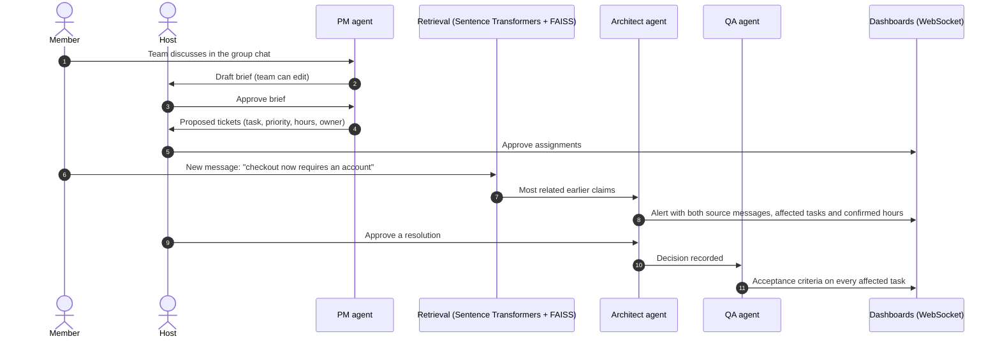
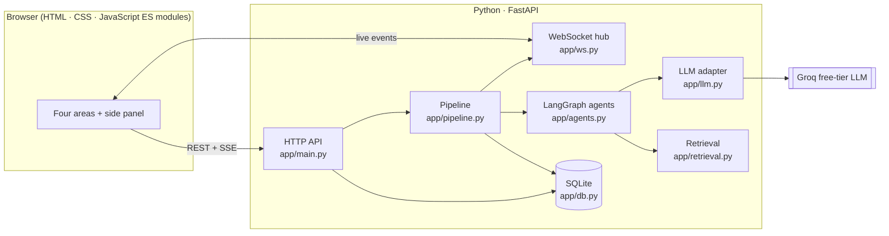

<p align="center">
  
</p>

<p align="center">
  <b>OlympAI Hackathon · Stage 1 prototype · Category 9–12 Advanced Coders</b><br>
  Team <b>Monarch Core</b> — Kavin K (team leader), Adrian Rohith, Sritharan N S
</p>

<p align="center">
  
  
  
  
  
  
  
</p>

---

## 🚀 Quick start for judges

### ▶ Try it live, with live AI: **<https://projecute.onrender.com>**

Nothing to install and no key needed: the hosted prototype runs the PM,
Architect and QA agents on a live language model for every visitor. Open the link
in **two browser tabs**, sign in as **Kavin K** (the host) in one and
**Sritharan N S** in the other, and follow the
[two-minute demo](#-two-minute-demo-script).

<details>
<summary>About the hosted version</summary>

- It runs on Render's free plan with the team's Groq key stored as a server
  secret. Visitors use the AI through the server and never see the key.
- A GitHub Action (`.github/workflows/keep-alive.yml`) pings it every 10 minutes,
  so it is awake when you click.
- To fit the free plan's memory, related-claim search uses the TF-IDF fallback.
  The live Architect agent still makes every conflict decision. The local and
  Codespaces versions below use the full Sentence Transformers + FAISS search.
- The data resets to the staged demo when the server restarts.

</details>

### Or run it yourself

Without a key these run in labelled demo mode; with a free Groq key they use
live AI too. Pick whichever is easiest:

| Option | Steps | Time |
|---|---|---|
| **A. In your browser (nothing to install)** | Click the button below → **Create codespace**. The app installs and opens by itself. | ~3–5 min the first time |
| **B. Windows** | Install [Python 3.11+](https://www.python.org/downloads/) (tick *Add python.exe to PATH*), unzip, double-click **`run.bat`** | ~5 min the first time |
| **C. macOS / Linux** | Unzip, then run `bash run.sh` in a terminal | ~5 min the first time |

<p align="center">
  <a href="https://codespaces.new/kavin-beep/Projecute-OlympAI-Hackathon?quickstart=1">
    
  </a>
</p>

Then open the app in **two browser tabs**. Sign in as **Kavin K** (the host) in
one and **Sritharan N S** in the other, and follow the
[two-minute demo](#-two-minute-demo-script).

> **Want the live AI agents?** Get a free key at
> [console.groq.com/keys](https://console.groq.com/keys) (about a minute, no
> payment). In Codespaces, paste it as `GROQ_API_KEY` on the *Create codespace*
> page. Locally, put it in the `.env` file the run script creates. The header
> shows **Live AI** or **Demo mode**, so you always know which you're seeing.

---

## Contents

1. [The problem](#-the-problem)
2. [What Projecute does](#-what-projecute-does)
3. [Features](#-features)
4. [How it works](#-how-it-works-the-agent-pipeline)
5. [Data and evaluation](#-data-and-evaluation)
6. [Setup and installation](#-setup-and-installation)
7. [Running the main code](#-running-the-main-code) and [troubleshooting](#-troubleshooting)
8. [Two-minute demo script](#-two-minute-demo-script)
9. [Every file and its purpose](#-every-file-and-its-purpose)
10. [Dependencies](#-dependencies)
11. [Privacy, ethics and security](#-privacy-ethics-and-security)
12. [AI tools used](#-ai-tools-used)
13. [What was verified, and what was not](#-what-was-verified-and-what-was-not)
14. [Known limitations](#-known-limitations)
15. [Future scope](#-future-scope)
16. [Team and acknowledgements](#-team-and-acknowledgements)

---

## 🧩 The problem

- Separate AI chats leave teammates with **different project assumptions**.
- Long chat threads **bury useful outputs** and agreed decisions.
- Unclear goals cause **duplicate tasks** and **conflicting technical plans**.
- Teams need organised work, shared decisions and **source evidence**.

## 🎯 What Projecute does

Projecute is a **multiplayer AI sprint and architecture manager**. Each person can
use AI privately to explore and learn. The team works in a shared space where AI
agents turn the discussion into a brief and tasks, and flag conflicts before
anyone builds the wrong thing. **The host approves every change to the shared
plan.**

| Goal (from the deck) | How the prototype delivers it |
|---|---|
| Use individual AI chat to explore ideas, ask questions and learn | Private chats with streamed AI answers, history, rename, delete and search |
| Create and organise reusable outputs | Individual workspace: named items (content, email, code, image, audio) in projects |
| Confirm one shared project brief and generate assigned tasks | PM agent drafts the brief; the team edits it and the host approves; PM proposes tickets with owners |
| Expose conflicts and affected work before implementation | Architect agent flags duplicates and contradictions, with source messages, affected tasks and hours |

---

## ✨ Features

### The four areas

| Area | What you can do |
|---|---|
| 💬 **Individual chat** | Private AI answers, ideas, explanations and learning. Streamed Markdown replies, chats grouped by date, rename, delete and search. Nothing here reaches the group unless you share it. |
| 👥 **Group chat** | Channels, replies, reactions and a typing indicator. Choose **public AI** (the answer is posted for everyone) or **private help** (only you see it; the group sees just *"Name used AI"*). The host can switch either mode off. |
| 🗂️ **Individual workspace** | Generate named items: content, email drafts, code (stored as text, never executed), images and audio. Organise them in projects, search by name, edit them, follow a link back to the source chat, and share an item to the group or make it private again. |
| 🏢 **Group workspace** | Six sections with live count badges: **Brief**, **Tasks**, **Decisions**, **Alerts**, **Activity** and **Team outputs**. |

### The AI agents

| Agent | Role |
|---|---|
| 🧭 **PM agent** | Reads the team chat, drafts the **project brief**, then proposes **tickets: task, priority, estimated hours and a suggested owner** |
| 🏗️ **Architect agent** | Uses embeddings and FAISS to find claims related to each new message, then decides: **duplicate**, **contradiction**, **assumption mismatch**, **unclear** or none |
| 🧪 **QA agent** | After the host resolves an alert, writes **acceptance criteria** for every affected task |

### Innovations (deck slide 10)

- **Decision impact.** Approved decisions are linked to the tickets they affect.
  Each affected ticket is shown **once**, and the alert totals only the
  **team-confirmed** estimated hours (e.g. *"Impact: 4 tasks, about 20 hours"*).
- **Parallel Futures.** Members answer the same concrete scenario independently.
  Comparing the answers reveals the hidden assumptions behind them.
- **Human Unit Test.** The task's creator and its assignee each describe the task
  in their own words. A mismatch is flagged before work starts.
- **Evidence on every flag.** Every alert quotes the exact source messages and who
  wrote them. The host approves the resolution.

### Host approvals

The host approves the **brief**, the **task assignments**, every **task edit**,
**alert resolutions** and **who can use AI** in the group. The server enforces
this, not just the interface, and tests cover it.

---

## ⚙️ How it works: the agent pipeline

<p align="center">
  
</p>



### The logic, step by step

1. **Brief.** The PM agent reads the busiest channel, so off-topic chatter in
   `#general` stays out, and drafts a structured brief: title, summary, goals,
   non-goals and assumptions. Any edit sends the brief back to *draft* until the
   host approves it again.
2. **Tickets.** After approval, the PM agent proposes 3–6 tickets. Near-duplicate
   proposals are dropped. Owners are matched to team members. The host approves
   the assignments.
3. **Conflict review.** Once a brief is approved, every new non-question message
   is compared with earlier messages:
   - **Retrieval:** `all-MiniLM-L6-v2` sentence embeddings searched with a FAISS
     inner-product index. A TF-IDF fallback is used if the model can't load.
   - **Meaning check:** the Architect agent classifies each related pair and
     keeps the most serious issue (contradiction > assumption > duplicate >
     unclear).
   - **Impact:** related tickets are retrieved for *both* source messages,
     de-duplicated, and their confirmed hours summed.
4. **Resolution.** The host picks or writes a resolution. It is recorded as a
   **decision**, and the QA agent writes acceptance criteria for each affected
   task.
5. **Live updates.** Every step is broadcast over WebSockets to each member's
   open windows, and logged in **Activity** with a timestamp.

### Reliable AI output

- Every AI JSON answer is validated with a **Pydantic schema**
  (`app/schemas.py`). If it doesn't validate, the error is sent back to the model
  for another try.
- Answers are **cached**. Rate limits and timeouts are retried with
  **exponential backoff**.
- Without an API key, or if the provider fails, the app switches to **labelled
  demo mode**. Text answers become fixed stand-ins, and the decisions come from
  transparent text rules. The header always says which mode is active.

### Architecture



---

## 📊 Data and evaluation

| Data | Where | Used for |
|---|---|---|
| Demo team conversation (written by the team, synthetic) | `scripts/seed_demo.py` | The staged demo: guest checkout, then a new login requirement |
| 18 planted conflict scenarios, each with 5 distractor claims | `scripts/evaluate_conflicts.py` | Detection and evidence correctness (deck: *15+ planted conflicts*) |
| 16 labelled duplicate pairs (synthetic, marked SYNTHETIC) | `data/sample_duplicates_SYNTHETIC.csv` | Smoke test for duplicate precision and recall |
| Kaggle GitHub Issues subset (planned) | not included | Benchmark duplicate precision and recall on real issues |

**Results.** Measured on 22 October 2026 on Windows 11 with Python 3.13. Conflict
decisions came from the built-in rules (no AI key), and claim search used
Sentence Transformers + FAISS:

```
pytest                 24 passed

evaluate_conflicts     18 scenarios  ·  detection 18/18  ·  evidence 16/16
                       contradiction 7/7 · assumption 4/4 · duplicate 4/4 · none 2/2 · unclear 1/1

evaluate_duplicates    16 synthetic pairs  ·  precision 1.000 · recall 1.000 · F1 1.000
```

> **Honest note.** Both evaluations are small and were written by the team, so
> they show that the pipeline works. They are not evidence of real-world
> accuracy. As the deck says, *Stage 1 makes no accuracy claims*. The **Kaggle
> GitHub Issues** benchmark has not been run yet. With the TF-IDF fallback instead
> of embeddings, an earlier run scored 17/18 on conflicts and recall 0.875 on
> duplicates.

To run the duplicate evaluation on a labelled Kaggle subset:

```bash
python -m scripts.evaluate_duplicates path/to/labelled.csv --limit 500
```

The CSV needs one labelled pair per row: `text_a,text_b,is_duplicate` (or
`title_a,title_b,label`).

---

## 🛠️ Setup and installation

**Requirements:** Python 3.11 or newer, and about 2 GB of disk space for
PyTorch and the embedding model.

The easiest way is `run.bat` (Windows) or `bash run.sh` (macOS/Linux): each one
creates a virtual environment, installs everything once, creates `.env`, starts
the app and opens your browser. To do the same by hand:

```bash
git clone https://github.com/kavin-beep/Projecute-OlympAI-Hackathon.git
cd Projecute-OlympAI-Hackathon
python -m venv .venv
# Windows: .venv\Scripts\activate    macOS/Linux: source .venv/bin/activate
pip install -r requirements.txt
```

**Optional, for live AI:** copy `.env.example` to `.env` and put your own
[Groq](https://console.groq.com) key in `GROQ_API_KEY`. Without a key the app
runs in **labelled demo mode**, and the whole demo still works.

The first run downloads the `all-MiniLM-L6-v2` embedding model (about 90 MB)
from Hugging Face. Offline, the app uses the TF-IDF fallback instead.

## ▶️ Running the main code

```bash
python main.py
```

Open <http://127.0.0.1:8000> in **two browser windows**. Sign in as **Kavin K**
(the host) in one and **Sritharan N S** in the other. Each window keeps its own
session. On a fresh database the demo team and project are created
automatically.

| Command | What it does |
|---|---|
| `python main.py` | Start the web app (the main entry point) |
| `python -m scripts.seed_demo` | Reset to the staged demo (stops just before the conflict) |
| `python -m scripts.seed_demo --full` | Reset and also run the conflict and its resolution |
| `python -m pytest` | Run the tests |
| `python -m scripts.evaluate_conflicts` | Planted-conflict evaluation |
| `python -m scripts.evaluate_duplicates data/sample_duplicates_SYNTHETIC.csv` | Duplicate evaluation |

**Settings** (environment variables or `.env`):

| Variable | Default | Purpose |
|---|---|---|
| `GROQ_API_KEY` | *(empty)* | Enables live AI; empty means demo mode |
| `GROQ_MODEL` | `llama-3.3-70b-versatile` | Groq model; tested with `openai/gpt-oss-120b` |
| `HOST` / `PORT` | `127.0.0.1` / `8000` | Where the server listens |
| `DEMO_PASSCODE` | *(empty)* | When set, **Load demo** asks for it before resetting |
| `PROJECUTE_DB` | `data/projecute.db` | SQLite database file |

### Run with Docker (optional)

The same app runs unchanged in a container on any Docker host, and live updates
over WebSockets keep working. Pass the API key as an environment variable or a
host secret, never in the files. `deploy/huggingface/README.md` holds the page
settings for a Hugging Face Docker Space, which needs a paid Hugging Face plan.

```bash
docker build -t projecute .
docker run -p 7860:7860 -e GROQ_API_KEY=your-key -e DEMO_PASSCODE=choose-one projecute
```

## 🩺 Troubleshooting

| Problem | Fix |
|---|---|
| `python` is not recognised (Windows) | Reinstall Python 3.11+ and tick **Add python.exe to PATH**, then open a new terminal |
| The page doesn't load right away | The first start downloads and loads the AI embedding model; wait about a minute. `run.bat` / `bash run.sh` open the browser when it's ready |
| `Address already in use` / port 8000 busy | Start on another port: `PORT=8010 python main.py` (Windows: `set PORT=8010` then `python main.py`) |
| Header says **Demo mode** | No Groq key is set. Add one to `.env` (or the Codespaces secret) and restart; see Quick start |
| No internet on first run | The app still starts and uses the TF-IDF search fallback; Settings → Advanced shows which search is active |
| Want a clean demo again | Press **Load demo** on the sign-in screen, or run `python -m scripts.seed_demo` |
| Codespace stopped after being idle | Reopen it from github.com/codespaces; the app starts again by itself |

---

## 🎬 Two-minute demo script

1. **The problem (10s).** Two windows side by side: Kavin the host and Sritharan
   a member. *"Two people, one project, and no shared idea of what was agreed."*
2. **Shared workspace → Brief (20s).** The PM agent wrote the brief from the
   team's own chat, and the host approved it. **Tasks** shows four tasks with
   owners, priorities and estimates the team confirmed.
3. **The scope change (25s).** In Sritharan's window, post in `#checkout`:
   > Update from the client: every customer must log in before they can pay, so
   > checkout now requires an account.
4. **The alert (35s).** In Kavin's window, open **Alerts**. The card says the
   messages disagree about checkout and quotes **both source messages** with
   their authors. It states the impact: **4 tasks, about 20 hours**.
5. **The host decides (20s).** Pick a resolution and press **Approve this
   resolution**. Sritharan's window updates on its own: the alert is resolved, a
   decision is recorded, and the QA agent's acceptance criteria appear.
6. **Privacy (20s).** In Sritharan's window, switch to **Private help** and ask
   anything. Kavin's window shows only *"Sritharan N S used AI"*, with no prompt,
   answer or topic. Finish on **Activity**: every agent action, timestamped.

---

## 📁 Every file and its purpose

| File | Purpose |
|---|---|
| `main.py` | **Main entry point.** Starts the web server (`python main.py`); reads `HOST`, `PORT` and `OPEN_BROWSER` |
| `run.bat` | One-command start for Windows: virtual environment, one-time install, `.env`, start, open browser |
| `run.sh` | The same one-command start for macOS and Linux |
| `.devcontainer/devcontainer.json` | GitHub Codespaces setup: installs dependencies, starts the app, opens it, and offers an optional `GROQ_API_KEY` secret |
| `render.yaml` | Render Blueprint for the hosted live demo (free plan); the Groq key is entered in Render as a secret |
| `requirements-render.txt` | Lighter dependency list for the hosted demo (no PyTorch, so it fits in 512 MB) |
| `.github/workflows/keep-alive.yml` | Pings the hosted demo every 10 minutes so it never sleeps |
| **app/** | **Backend (Python)** |
| `app/__init__.py` | Marks `app` as a Python package |
| `app/main.py` | FastAPI application: every HTTP endpoint for the four areas, sign-in, permission checks (member, host, same group), server-sent events for streamed chat, the WebSocket endpoint and the static frontend |
| `app/pipeline.py` | The group pipeline as plain functions over the database: brief → tickets → conflict review → decision → QA. Returns the live events to broadcast |
| `app/agents.py` | The PM, Architect and QA agents, Parallel Futures and Human Unit Test comparisons, the two LangGraph graphs (planning and review), and the rule-based demo-mode logic |
| `app/llm.py` | Groq adapter: JSON validation with retries, answer cache, exponential backoff, streaming, and labelled demo mode. Never logs or returns the key |
| `app/retrieval.py` | Related-claim search with Sentence Transformers + FAISS, and the TF-IDF fallback |
| `app/schemas.py` | Pydantic schemas that every AI JSON answer is validated against |
| `app/db.py` | SQLite schema, query helpers, membership and host checks, activity log |
| `app/ws.py` | WebSocket hub: tracks open windows per user and pushes live events |
| `app/media.py` | Image and audio adapter; labelled placeholder mode when no provider key is set |
| **static/** | **Frontend (HTML, CSS, JavaScript, no build step)** |
| `static/index.html` | Page layout: sign-in screen, navigation rail, the four areas, side panel |
| `static/styles.css` | Visual design, light and dark themes, mobile layout |
| `static/logo.svg` | Projecute logo (original) |
| `static/js/app.js` | App start-up, sign-in, navigation between areas, theme, Load demo |
| `static/js/api.js` | API calls, streamed responses, the live WebSocket connection and event bus |
| `static/js/ui.js` | Shared UI helpers: elements, icons, dialogs, toasts, safe Markdown, time formatting |
| `static/js/chat.js` | Individual chat |
| `static/js/group.js` | Group chat: channels, messages, reactions, replies, AI modes, host controls |
| `static/js/workspace.js` | Individual workspace: projects, named items, sharing |
| `static/js/board.js` | Group workspace: Brief, Tasks, Decisions, Alerts, Activity, Team outputs, Parallel Futures, Human Unit Test |
| **scripts/** | **Command-line tools** |
| `scripts/seed_demo.py` | Resets the database and stages the demo team, chat, approved brief and tasks |
| `scripts/evaluate_conflicts.py` | Scores the 18 planted conflict scenarios |
| `scripts/evaluate_duplicates.py` | Scores duplicate detection on any labelled CSV of pairs |
| `scripts/__init__.py` | Marks `scripts` as a package so the tools run with `python -m` |
| **tests/** | **Automated tests (pytest)** |
| `tests/conftest.py` | Test setup: a separate temporary database and a seeded demo |
| `tests/test_privacy.py` | Private chats, items, private AI help, group isolation, no cross-group access |
| `tests/test_approvals.py` | Host-only approvals: brief, assignments, task edits, AI access, resolutions |
| `tests/test_live_updates.py` | WebSocket updates reach the other member's window |
| `tests/test_llm_recovery.py` | Live AI comes back by itself after a provider error |
| `tests/__init__.py` | Marks `tests` as a package |
| **data/** | |
| `data/sample_duplicates_SYNTHETIC.csv` | 16 synthetic labelled pairs for the duplicate smoke test |
| `data/projecute.db` | SQLite database, created at run time (git-ignored) |
| **assets/** | |
| `assets/banner.svg`, `assets/pipeline.svg` | Animated images used in this README (original) |
| **Project files** | |
| `requirements.txt` | Python dependencies |
| `.env.example` | Template for `.env` (no real keys) |
| `.gitignore` | Keeps `.env`, the database and caches out of git |
| `.gitattributes` | Keeps Windows line endings in `run.bat` and Unix line endings in `run.sh` |
| `Dockerfile` | Container image for Hugging Face Spaces or any Docker host |
| `.dockerignore` | Keeps `.env` and local data out of the image |
| `deploy/huggingface/README.md` | Page settings for an optional Hugging Face Docker Space (needs a paid Hugging Face plan) |
| `README.md` | This document |

---

## 📦 Dependencies

All listed in `requirements.txt`. Install with `pip install -r requirements.txt`.

| Library | Used for |
|---|---|
| `fastapi` | Web framework for the HTTP API and WebSockets |
| `uvicorn[standard]` | Server that runs the FastAPI app |
| `websockets` | WebSocket support for live updates |
| `pydantic` | Validating every AI JSON answer against a schema |
| `python-multipart` | Form and request-body parsing for FastAPI |
| `groq` | Client for the Groq free-tier LLM API |
| `langgraph` | Orchestrating the agent graphs |
| `sentence-transformers` | Local sentence embeddings (`all-MiniLM-L6-v2`) |
| `faiss-cpu` | Fast similarity search over embeddings |
| `numpy` | Vector maths and the TF-IDF fallback |
| `pytest`, `httpx` | Automated tests |

No frontend framework or build step: the browser loads plain JavaScript modules.
Fonts (Sora, IBM Plex Sans) come from Google Fonts under the SIL Open Font
License.

---

## 🔒 Privacy, ethics and security

Following deck slide 14, these rules are enforced by the server, not just hidden
in the interface:

- **Individual chats enter the group only through explicit sharing.**
- **The group AI reads only that group's messages.** Private prompts and replies
  stay isolated.
- **Private AI use is announced, but the prompt, answer and topic stay hidden.**
- **The host approves** settings, permissions, roles and changes to the shared
  plan.
- **Groups are isolated.** Channels, messages and scenarios must belong to the
  group named in each request.
- **Public or synthetic demo text only**, and API keys live in `.env` or Space
  secrets, never in the code.
- **Code is never executed**: generated code is stored and edited as text only.

---

## 🤖 AI tools used

The competition rules require naming every AI tool used. We used:

| Tool | What it was used for |
|---|---|
| **OpenAI ChatGPT / Codex** | Generated most of the application code under the team's direction, and helped with brainstorming, project guidance and presentation preparation |
| **Claude Code (Anthropic, Claude Opus 5.5)** | Reviewed the prototype against the deck and the challenge brief, fixed cross-group access bugs, made task edits host-only, added code comments, the one-command and GitHub Codespaces setup, the Docker setup, and this README |

The team chose the problem, designed the concept, the deck and the demo story, and
directed the AI tools.

**AI models inside the app** (runtime, not used to write code):

| Model | Purpose |
|---|---|
| Groq-hosted LLM (`openai/gpt-oss-120b`, configurable) | PM, Architect and QA agents; chat answers; workspace generation |
| `sentence-transformers/all-MiniLM-L6-v2` | Embeddings for related-claim retrieval |

---

## ✅ What was verified, and what was not

**Verified:**

- 24 automated tests: privacy, host approvals, group isolation, the demo passcode, live-AI recovery and live updates.
- The full demo flow: brief → host approval → tasks → new login requirement →
  alert with sources, affected tasks and hours → host resolution → QA criteria.
- Sentence Transformers + FAISS retrieval and both evaluations (results above).
- The demo flow on live AI (`openai/gpt-oss-120b`) with the hosted build's
  dependencies: the PM agent wrote the brief and 5 tasks, and the new login
  requirement raised a contradiction alert quoting Adrian's and Sritharan's
  messages, with "3 tasks, about 15 hours" of impact. The server used about
  100 MB of memory.
- Earlier browser testing with two users at once: all four areas, both themes,
  and the 390 px mobile layout.

**Not yet verified:**

- Host resolution and QA criteria on live AI in the browser (covered in demo mode
  and by the tests).
- The Kaggle GitHub Issues benchmark.
- More than three users, more than one group per person, and long sessions.

## ⚠️ Known limitations

- **No passwords.** Picking a name signs you in. This is a prototype, not an
  authentication system, but the permission rules behind it are real and tested.
- **Demo mode text is a fixed stand-in.** It is clearly labelled. The conflict
  *decisions* in demo mode come from transparent text rules.
- **The TF-IDF fallback matches wording, not meaning**, so it is used only when
  the embedding model can't load.
- **Conflict review runs on new messages** after the brief is approved, and
  skips questions. **Alerts → Check the chat again** re-scans everything.
- **Images and audio are placeholders** without a media provider key, labelled
  in the interface.
- **SQLite, single process.** Fine for a demo, not for many concurrent teams.
  In a Docker container the data resets when the container is recreated.
- **After a provider error the app answers in demo mode for 30 seconds**, then
  returns to live AI by itself. The header shows which mode is active.
- **The hosted demo shares one Groq free-tier key**, so many judges at the same
  moment can hit its rate limit. Requests are retried with backoff first.

## 🔭 Future scope

- Connect GitHub issues, documents and meeting-summary sources.
- Support larger teams and more detailed permission policies.
- Add multilingual evaluation and improved dependency visualisation.
- Expand beyond the prototype after measured user feedback.

---

## 👥 Team and acknowledgements

| Member | Contribution |
|---|---|
| **Kavin K** (team leader) | Backend, permissions and live collaboration |
| **Adrian Rohith** | Chat interface and connected workspace |
| **Sritharan N S** | AI workflow, evaluation and demo preparation |

Thanks to the **OlympAI Hackathon** organisers and **MethodAI**, to our mentor
for her guidance and support, and to the open-source projects listed under
[Dependencies](#-dependencies).

<p align="center"><sub>Projecute — from team discussion to approved project work.</sub></p>
